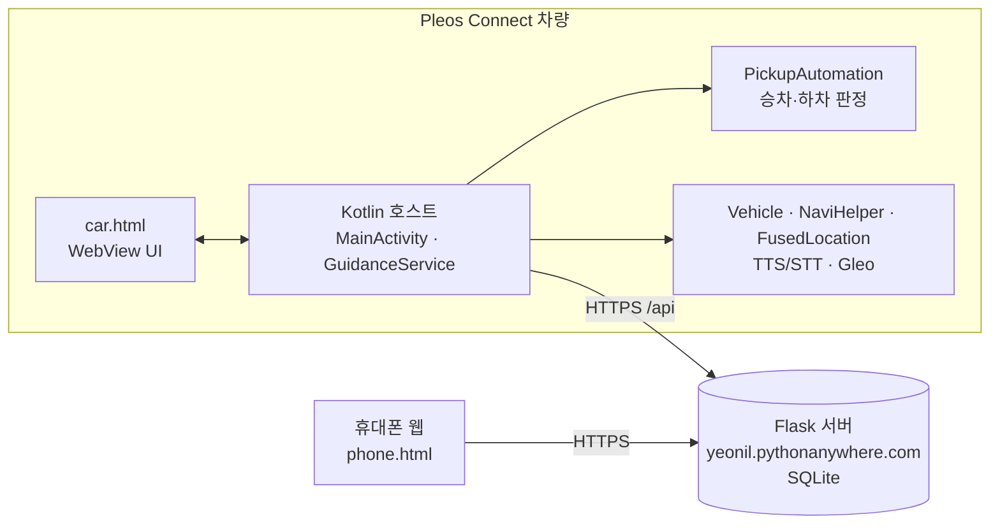

# Pooly (풀리)

> 일행을 태우러 가는 운전자를 위한 Pleos Connect 픽업 앱
> 현대자동차그룹 차량용 앱 개발 공모전 출품작

Pooly는 약속 장소까지 일행을 차례로 태워 가는 **픽업 이동**을 차량 안에서 관리합니다.
탑승자는 휴대폰 웹에서 픽업 위치를 고르고, 차량은 **좌석 점유 신호**로 승차와 하차를 스스로 확인합니다.
탑승이 확인되면 그 사람이 저장해 둔 **좌석 설정(열선·통풍·시트 메모리)**을 적용하고, 다음 픽업지로 내비 경로를 갱신합니다.

- 서버: **https://yeonil.pythonanywhere.com** (Flask · PythonAnywhere) — 차량 앱과 휴대폰 웹은 이 서버 하나만 사용합니다.
- 검증 환경: Pleos Connect 에뮬레이터 2.1.0 (Android API 34, ARM64) · Vehicle SDK 2.3.2

---

## 핵심 기능

| # | 기능 | 동작 | 사용 신호/SDK |
|---|---|---|---|
| 1 | **픽업 약속과 위치 공유** | 차량에서 약속(목적지·시간·픽업할 일행)을 만들고 초대 링크를 보냅니다. 일행은 휴대폰 웹에서 참가해 픽업 위치를 고르고, 원하면 이동 중 위치를 공유합니다. | NaviHelper(경로·ETA), FusedLocation, 브이월드 장소 검색, OpenFreeMap |
| 2 | **픽업 위치 추천** | Pooly 이동 중 차량이 **정차 기록**(약 50m 칸 위치·정차 시간·시간대·승차/하차)을 서버에 쌓고, 탑승자 지도에 **추천 위치를 최대 8곳**을 보여 줍니다. 자주 타고 짧게 정차한 가까운 곳이 위로 오며, 기록이 5건 이상인 칸만 씁니다. 기록이 부족하면 가상 데이터 예시를 보여 줍니다. 추천 위치를 누르면 바로 픽업 위치로 선택됩니다. | Vehicle: 속도·좌석 점유 / NaviHelper 위치 |
| 3 | **자동 승차 확인** | 픽업 지점 80m 이내에서 동승석이 *비어 있음 → 점유*로 바뀌면 현재 픽업 대상의 승차로 기록하고 "B 님 승차 완료 · C 님에게 이동 중" 알림을 7초간 내비 위에 띄웁니다. 다음 픽업지로 내비를 전환하며 마지막 탑승 뒤에는 최종 목적지를 안내합니다. | Vehicle: 좌석 점유, 운전석 위치, 기어·속도 / NaviHelper |
| 4 | **자동 하차 확인** | 승차 때 연결된 좌석이 정차 중 *점유 → 비어 있음*으로 바뀌어 1.5초 이상 유지되면 그 일행의 하차로 기록하고 알림을 띄웁니다. 비워진 좌석은 다음 일행에게 다시 연결될 수 있습니다. | Vehicle: 좌석 점유, 기어·속도 |
| 5 | **좌석 사용자화** | 승차가 확인된 좌석에만, 탑승 시점의 **실내 온도**로 판단해 저장된 단계를 적용합니다. 20℃ 이하면 열선, 26℃ 이상이면 통풍, 그 사이에는 둘 다 끕니다. 차량별로 저장한 시트 메모리 슬롯을 불러옵니다. | Vehicle: 실내 온도, 열선/통풍, 좌석 메모리 |
| 6 | **음성 제어** | Gleo App Action 3개 — 픽업 상태 조회, 남은 픽업지로 안내 시작, 현재 일행에게 도착 알림. 안내 시작과 도착 알림은 차량 화면에서 한 번 더 확인한 뒤 실행합니다. | Gleo, TTS/STT |

탑승자의 좌석 설정은 휴대폰 웹 **내 정보 → 내 좌석 설정**에서 저장합니다. 기본값은 *자동 적용 꺼짐*이며, 다른 일행의 설정은 조회할 수 없습니다.

## 시스템 구성



- 차량 UI(`pooly/web/car.html`)는 APK에 번들되고, API 호출은 네이티브 브리지(`PoolyApi`)를 거쳐 서버로 갑니다. 앱은 `BuildConfig.API_BASE_URL` 외의 주소로는 요청하지 않습니다.
- 내비가 앱을 가려도 `GuidanceService`의 `PickupAutomation`이 0.5초마다 차량 신호를 확인합니다.
- 서버는 운전자 권한, 현재 픽업 대상, 위치(80m), 신호 시각(15초 이내), 좌석·차량 일치, 중복 관찰 ID를 **다시 검증**한 뒤에만 승차·하차를 기록합니다.

## 실행 방법

### 1. 서버

이미 배포되어 있으므로 따로 실행할 필요가 없습니다. 상태 확인: <https://yeonil.pythonanywhere.com/health>
직접 배포하려면 [PythonAnywhere 배포 가이드](pooly/deploy/PYTHONANYWHERE.md)를 참고하세요.

### 2. 차량 앱 빌드·설치

준비물: Android Studio, Pleos Connect 에뮬레이터 2.1.0(AVD 이름 `Pleos_Connect_2_1`), JDK 17.
Pleos SDK는 `nexus-playground.pleos.ai` 저장소에서 받습니다([settings.gradle.kts](android/Pooly/settings.gradle.kts)).

```sh
cd android/Pooly
./gradlew :app:assembleDebug          # → pooly/artifacts/pooly.apk
adb install -r ../../pooly/artifacts/pooly.apk
# 또는 에뮬레이터 실행부터 설치·실행까지 한 번에 (macOS)
./scripts/run-pleos.sh
```

Gradle이 `pooly/web`을 앱 assets로 읽으므로 저장소 폴더 구조를 그대로 유지해 주세요.
패키지 이름은 `io.pooly.app`입니다.

### 3. 시연 순서

1. **약속 만들기 (차량)** — 목적지와 시간을 정하고 픽업할 일행을 추가한 뒤 *초대 보내기*로 링크를 공유합니다.
2. **참가 (휴대폰)** — 초대 링크(`https://yeonil.pythonanywhere.com/phone.html?invite=…`)를 열어 참가하고, 지도에서 픽업 위치를 고릅니다. 번호 핀(추천 위치)을 눌러도 됩니다. *내 정보 → 내 좌석 설정*에서 자동 적용과 열선·통풍 단계를 저장합니다.
3. **출발 (차량)** — *출발*을 누르면 Pleos 내비에 픽업지 → 목적지 경로가 설정됩니다.
4. **차량 신호 조작** — 에뮬레이터의 Virtual Console을 엽니다.
   ```sh
   adb forward tcp:8088 tcp:8088     # 브라우저에서 http://127.0.0.1:8088/
   ```
   *Emulation Controls → Convenience → Seat Occupancy*에서 동승석(Passenger)을 **Occupied**로 바꾸면 승차 완료 알림과 좌석 설정 적용, 다음 목적지 경로 갱신을 확인할 수 있습니다. 다시 **Empty**로 바꾸면(정차 상태, P단) 하차 완료 알림이 뜹니다.
   에뮬레이터 시연에서는 서버에 `POOLY_PICKUP_REQUIRE_PROXIMITY=0`을 설정해 내비 위치와 관계없이 착석 신호로 자동 승차를 시연합니다. 설정 방법은 [PythonAnywhere 배포 가이드](pooly/deploy/PYTHONANYWHERE.md)의 환경변수 항목을 참고하세요.

## 자동 승하차 판정 규칙

**승차** (`PickupPolicy.update` → 서버 `auto_board`)
- 운전자 기기이고, 내비가 이 약속을 안내 중이며, 단계가 이동/근접/도착 중일 것
- 기본 설정에서는 현재 픽업 위치에서 80m 이내 (위치 신호 10초 이내). 시연 설정 `POOLY_PICKUP_REQUIRE_PROXIMITY=0`에서는 이 조건을 생략
- 운전석이 아닌 좌석 **하나만** 새로 *비어 있음 → 점유* (동시에 두 좌석이 바뀌면 추측하지 않음)
- 픽업 구간이 시작된 뒤 생긴 변화일 것 (멀리서 이미 앉아 있던 좌석은 제외)

**하차** (`PickupPolicy.alight` → 서버 `auto_alight`)
- 승차 때 좌석이 연결된 일행만, 같은 차량(앱 설치별 무작위 차량 키)에서
- 정차(P단, 속도 0.3m/s 이하) 중 그 좌석이 *점유 → 비어 있음*으로 바뀌고 1.5초 이상 유지
- 승차 시각 이후의 변화일 것, 같은 사람은 한 번만 하차

**정차 기록** (`StopRecorder` → 서버 `POST /api/appointments/<id>/stops`) — 추천용 데이터 수집이며, 위의 승하차 확정과는 별개입니다.
- 속도 1km/h 이하에서 정차 시간 카운트 시작, 3km/h 이상이 되면 정차 종료
- 정차 중 운전석이 아닌 좌석이 바뀌어 1.5초 이상 유지되면 승차(비어 있음→점유) 또는 하차(점유→비어 있음)
- 좌석 변화가 없으면 3km/h에서 카운트 초기화(신호 대기 등은 저장하지 않음)
- 저장하지 않는 정차: 출발 전 첫 정차(집·주차장에서 타는 경우), 10분을 넘는 정차
- 저장하는 값: 약 50m 칸으로 반올림한 위치, 정차 시간(초), 시간대(0~23시), 승차/하차. 사용자·차량·약속·정확한 시각은 저장하지 않습니다.

문 열림이나 수동 '준비 완료'는 판정에 쓰지 않습니다. 수동 확인 버튼(픽업 장소 도착 확인 등)은 신호를 쓸 수 없는 경우를 위한 보조 수단입니다.

## 실제 데이터 / 가상 데이터 구분

| 항목 | 상태 |
|---|---|
| 좌석 점유, 기어·속도, 실내 온도, 열선/통풍, 좌석 메모리 | Pleos Vehicle SDK 실제 신호 (에뮬레이터 Virtual Console로 조작) |
| 경로·ETA·현재 위치 | Pleos NaviHelper / FusedLocation 실제 값 |
| 약속·초대·승하차 기록·좌석 설정 | 배포 서버 SQLite에 저장되는 실제 데이터 |
| 추천 픽업 위치 | **실제 정차 기록 기반**(칸당 5건 이상). 기록이 부족한 지역에서는 성수·건대입구·왕십리 일대의 **가상 정차 데이터 예시**를 대신 보여 주고 화면에 '예시'로 표시합니다. |
| 픽업 히트맵 | 가상 정차 데이터 예시 |
| 도로 그래프 기반 추천 모델(GNN) | **가상 도시 데이터로 학습·검증 완료**([ml/](ml/README.md)). 학습하지 않은 지역에서 단순 평균보다 오차 약 42% 감소. 실제 도로망·공공데이터 적용과 서비스 연결은 다음 단계입니다. |

## 테스트

```sh
# 서버 (프로젝트 루트, Python 3.11+)
python3 -m pip install -r pooly/requirements.txt
python3 -m unittest discover -s pooly/tests -t .

# 차량 앱 판정 로직 단위 테스트
cd android/Pooly && ./gradlew :app:testDebugUnitTest
```

계측 테스트(`connectedAndroidTest`)는 사용자 앱을 지우지 않도록 별도 ID(`io.pooly.app.integration`)로 설치됩니다.

## 폴더 구조

```
android/Pooly/            Pleos 차량 앱 (Kotlin)
  app/src/main/java/io/pooly/app/
    MainActivity.kt         WebView 호스트, 네이티브 브리지
    PoolyApi.kt             서버 통신 (배포 서버 주소만 허용)
    PickupPolicy.kt         승차·하차·온도 판정 (순수 로직)
    StopRecorder.kt         추천용 정차 기록 수집 (순수 로직)
    PickupAutomation.kt     판정 결과를 서버에 기록하고 좌석 설정·경로 갱신
    GuidanceService.kt      내비 상태 동기화, 백그라운드 자동화
    PleosVehicle.kt · SeatPersonalizer.kt · PleosNavigation.kt · PleosLocation.kt · PleosVoice.kt
    GleoActivity.kt · GleoContract.kt   Gleo 음성 명령
  scripts/run-pleos.sh      에뮬레이터 실행·설치 스크립트
pooly/
  server/                   Flask API (domain.py: 약속·픽업·승하차 규칙)
  web/                      car.html(차량 UI) · phone.html(휴대폰 웹) · pickup-heatmap.js(추천 핀·히트맵)
  tests/                    서버 테스트
  deploy/                   PythonAnywhere WSGI·배포 가이드
  artifacts/gleo-schema.json  Gleo 명령 스키마
  scripts/                  배포 ZIP 생성, Virtual Console 열기
ml/                       픽업 위치 추천 GNN 실험 (가상 도시 데이터)
docs/oem-map-diagnosis.md   알려진 이슈: 에뮬레이터 내장 내비 배경 지도
```

## 알려진 제한

- 실차가 아닌 Pleos 에뮬레이터에서만 검증했습니다. 실차의 GPS 근접 판정과 시트 모터 구동 완료는 확인하지 않았습니다.
- 에뮬레이터 내장 내비의 배경 지도가 비어 보이는 현상은 앱과 무관한 환경 문제입니다 → [docs/oem-map-diagnosis.md](docs/oem-map-diagnosis.md)
- Gleo 스키마의 공식 검토·활성화와 실제 Gleo 발화 호출은 아직 검증하지 않았습니다.
- 한 일정에 일행을 최대 12명까지 추가할 수 있습니다. 내비는 픽업 위치를 순서대로 한 곳씩 안내합니다.
- 자동 하차는 이동이 진행 중인 동안(픽업 구간·목적지 이동·주차)만 기록합니다. 목적지 도착으로 이동이 종료된 뒤 내리는 경우는 기록하지 않습니다.
