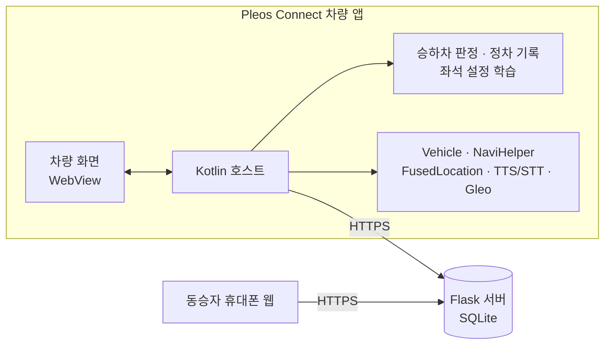

<p align="center">
  
</p>

<h3 align="center">차가 실제로 사람을 태운 기록으로, 정차하기 좋은 픽업 위치를 추천합니다</h3>

<p align="center">
  일행을 태우러 갈 때, 만나는 순간부터 탑승 이후까지 돕는 Pleos Connect 픽업 앱<br>
  <sub>현대자동차그룹 차량용 앱 개발 공모전 출품작 · 팀 드림카 아반떼</sub>
</p>

<p align="center">
  
  
  
  
  
</p>

---

## 개요

일행을 태우러 가면 상대가 아직 나오지 않아 기다리거나, 지금 어디쯤인지 몇 번이고 설명하게 됩니다.
더 큰 문제는 어디서 태울지입니다. 운전을 하지 않는 사람은 어느 위치가 차를 정차하기 쉬운 위치인지 알지 못합니다.

Pleos 차량은 좌석 점유와 속도 신호로 **실제로 사람을 태운 정차**를 알아낼 수 있습니다.
Pooly는 이 데이터를 수집해 지도에는 없는 픽업을 하기에 좋은 위치를 동승자에게 추천합니다.

## 한눈에 보기

| | 기능 | 하는 일 |
|:-:|---|---|
| ① | **딥러닝 기반 픽업 위치 추천** · 핵심 | 차량이 기록한 승차 정차로 정차하기 좋은 곳을 추천하고, 도로망 그래프 신경망(GNN)으로 기록이 없는 도로까지 예측 (차후 개발 예정) |
| ② | **픽업 일정과 경로 자동 설정** | 일정·일행·픽업 위치를 정하면 내장 내비에 픽업 위치를 한 곳씩 바로 전달 |
| ③ | **차량 신호 기반 자동 승하차 확인** | 좌석 점유 변화로 승차·하차를 판정하고 "B 님 탑승 완료 · C 님에게 이동 중" 안내, 경로 자동 갱신 |
| ④ | **동승자 좌석 사용자화** | 동승자가 차에서 바꾼 열선·통풍·희망 온도·바람 방향을 기억해, 다음 탑승 때 실내 온도에 맞춰 적용 |

---

## ① 딥러닝 기반 픽업 위치 추천

**데이터 수집.** 차량이 정차하여 승객을 태웠을 때, 해당 위치와 정차 시간, 시간대 등의 데이터를 수집합니다.

**추천.** 동승자가 픽업 위치를 고를 때, 주변에서 승차 기록이 5건 이상 쌓인 지점을 *자주 타고 · 짧게 정차하고 · 가깝고 · 지금과 비슷한 시간대*인 순서로 최대 8곳 보여 줍니다. 사람이 많이 탔더라도 오래 서 있어야 했던 곳은 순위가 낮습니다. 추천 위치를 누르면 바로 픽업 위치로 정해집니다. 기록이 부족한 지역은 가상 데이터 예시를 보여 주고 화면에 '예시'로 표시합니다.

**GNN(그래프 신경망)** 어떤 도로가 픽업하기 좋은지는 그 도로 하나로 정해지지 않습니다. Pooly는 도로 구간을 노드, 이어진 구간을 엣지로 하는 도로망 그래프에서 이웃 구간의 정보를 모아 픽업 품질을 예측하도록 학습합니다. 그래서 승차 기록이 없는 도로도 이웃 구간을 바탕으로 예측할 수 있습니다. (차후 개발 예정)

## ② 픽업 일정과 경로 자동 설정

- 운전자는 차량 화면에서 목적지·날짜·시간을 정하고 친구 목록에서 일행을 추가합니다(최대 12명).
- 동승자는 추천 위치를 참고해 자신의 픽업 위치를 정합니다.
- 출발하면 첫 픽업 위치를 내장 내비에 바로 전달하고, 탑승이 확인될 때마다 다음 픽업 위치와 최종 목적지로 이어서 안내합니다.
- 출발 뒤에는 동승자가 차의 위치와 남은 시간을 확인할 수 있습니다.

## ③ 차량 신호 기반 자동 승하차 확인

- **승차:** 픽업 장소에서 운전석이 아닌 좌석 하나가 *비어 있음 → 점유*로 바뀌면 현재 픽업 대상의 승차로 기록합니다. 내비 위에 "B 님 탑승 완료 · C 님에게 이동 중"을 7초간 띄우고 다음 경로로 바꿉니다.
- **하차:** 승차 때 연결된 좌석이 정차 중 *점유 → 비어 있음*으로 바뀌어 1.5초 이상 유지되면 하차로 기록합니다.
- 서버는 운전자 권한, 현재 픽업 대상, 신호 시각(15초 이내), 좌석·차량 일치, 중복 관찰 ID를 **다시 검증**한 뒤에만 기록합니다.
- 이 승하차 판정이 곧 ① 픽업 위치 추천의 학습 데이터가 됩니다.

## ④ 동승자 좌석 사용자화

동승자가 탑승하면 이전의 설정 기록을 적용합니다.

| 설정 | 기억하는 조건 | 다음 탑승 때 적용 |
|---|---|---|
| 열선 | 실내 20℃ 이하에서 바꾼 단계 | 탑승 시점 실내 20℃ 이하 |
| 통풍 | 실내 26℃ 이상에서 바꾼 단계 | 탑승 시점 실내 26℃ 이상 |
| 희망 온도 · 바람 방향 | 동승자 좌석의 공조 구역이 운전석과 분리된 경우 | 같은 조건에서 적용 |
| 시트 자세 | 그 차량에 저장된 좌석 메모리 | 탑승이 확인된 좌석에 불러오기 |

- 적용은 **승차가 확인된 좌석에만** 하고, **탑승 시점의 실내 온도**로 판단합니다. 지난번 20℃ 이하에서 열선을 켰더라도 오늘 실내가 20℃를 넘으면 켜지 않습니다.

**음성 (Gleo App Action):** 픽업 상태 확인, 남은 픽업 위치로 안내 시작, 현재 일행에게 도착 알림. 안내 시작과 도착 알림은 차량 화면에서 한 번 더 확인한 뒤 실행합니다.

## 시스템 구성



| 구성 | 역할 |
|---|---|
| 차량 앱 (Kotlin) | 차량 화면, Pleos SDK 연동. 내비가 앞에 떠 있어도 백그라운드에서 승하차 판정·정차 기록·좌석 학습을 계속합니다. |
| 서버 (Flask · SQLite) | 일정·초대·픽업 상태·승하차 기록·좌석 설정·정차 기록 저장, 승하차 재검증, 추천 API |
| 동승자 웹 | 설치 없이 초대 링크로 참여, 픽업 위치·추천, 차량 위치 확인, 좌석 설정 |

### 사용한 Pleos SDK / API

| SDK | 사용 내용 |
|---|---|
| Vehicle SDK 2.3.2 | 좌석 점유(승하차 판정), 속도·기어(정차 판정), 실내 온도, 좌석 열선/통풍·희망 온도·바람 방향 읽기와 제어, 좌석 메모리 |
| NaviHelper 3.0.5 | 픽업 위치·목적지 경로 요청, 안내 상태·남은 시간·남은 거리·현재 위치, 도착 이벤트 |
| FusedLocation | 차량 위치 수신, 동승자에게 위치 공유 |
| TTS / STT 3.3.1 | 승차·도착 음성 안내 |
| Gleo App Action | 픽업 상태 확인, 남은 픽업 안내 시작, 도착 알림 |
| 외부 | 브이월드 장소 검색, OpenFreeMap(동승자 웹 지도) |

---

## 실행 방법

### 차량 앱 설치

준비물: Android Studio, Pleos Connect 에뮬레이터 2.1.0(AVD `Pleos_Connect_2_1`), JDK 17.
Pleos SDK는 `nexus-playground.pleos.ai` 저장소에서 받습니다([settings.gradle.kts](android/Pooly/settings.gradle.kts)).
앱은 배포된 Pooly 서버에 자동으로 연결되므로 서버를 따로 실행할 필요가 없습니다.

```sh
cd android/Pooly
./gradlew :app:assembleDebug          # → pooly/artifacts/pooly.apk
adb install -r ../../pooly/artifacts/pooly.apk
# 또는 에뮬레이터 실행부터 설치·실행까지 한 번에 (macOS)
./scripts/run-pleos.sh
```

Gradle이 `pooly/web`을 앱 화면으로 묶으므로 저장소 폴더 구조를 그대로 유지해 주세요. 패키지 이름은 `io.pooly.app`입니다.

### 에뮬레이터에서 시연하기

1. **일정 만들기 (차량):** 목적지·시간을 정하고 일행을 픽업 대상으로 추가한 뒤 초대를 보냅니다.
2. **참가 (휴대폰):** 초대 링크로 참가해 픽업 위치를 고릅니다. 추천 위치를 눌러도 됩니다.
3. **출발 (차량):** 첫 픽업 위치가 내장 내비에 설정됩니다.
4. **차량 신호 조작:** Virtual Console을 엽니다.
   ```sh
   adb forward tcp:8088 tcp:8088     # 브라우저에서 http://127.0.0.1:8088/
   ```
   - *Seat Occupancy*에서 동승석을 **Occupied**로 바꾸면 탑승 완료 알림과 다음 경로가 나타납니다.
   - 실내 온도를 20℃ 이하로 두고 탑승 중 조수석 열선을 켜면 "좌석 설정 저장" 알림이 뜹니다. 다음 운행에서 같은 일행이 앉으면 열선이 자동으로 켜집니다.
   - 정차(P단) 중 좌석을 **Empty**로 바꾸면 하차 완료 알림이 뜹니다.

> 에뮬레이터의 내비 위치는 픽업 지점까지 움직이지 않으므로, 시연 서버는 `POOLY_PICKUP_REQUIRE_PROXIMITY=0`으로 픽업 지점 80m 조건만 끄고 운영합니다. 자세한 설정은 [배포 가이드](pooly/deploy/PYTHONANYWHERE.md)에 있습니다.

<details>
<summary><b>자동 판정 규칙 자세히</b></summary>

**승차** (`PickupPolicy.update` → 서버 `auto_board`)
- 운전자 기기이고, 내비가 이 약속을 안내 중이며, 단계가 이동·근접·도착 중일 것
- 현재 픽업 위치에서 80m 이내 (위치 신호 10초 이내, 시연 설정에서는 생략)
- 운전석이 아닌 좌석 **하나만** 새로 *비어 있음 → 점유* (두 좌석이 동시에 바뀌면 추측하지 않음)
- 픽업 구간이 시작된 뒤 생긴 변화일 것

**하차** (`PickupPolicy.alight` → 서버 `auto_alight`)
- 승차 때 좌석이 연결된 일행만, 같은 차량(앱 설치별 무작위 차량 키)에서
- 정차(P단, 0.3m/s 이하) 중 그 좌석이 *점유 → 비어 있음*으로 바뀌고 1.5초 이상 유지
- 승차 이후의 변화일 것, 한 사람당 한 번

**정차 기록** (`StopRecorder` → 서버 `/stops`)
- 1km/h 이하에서 시작, 3km/h 이상에서 종료, 좌석 변화가 없으면 저장하지 않음
- 출발 전 첫 정차와 10분 초과 정차는 저장하지 않음

**좌석 설정 학습** (`PickupAutomation` → 서버 `/seat-learning`)
- 탑승 직후 15초 동안 앱이 적용한 변화는 학습하지 않고, 바뀐 항목만 전송
- 희망 온도·바람 방향은 운전석과 공유하지 않는 공조 구역일 때만

문 열림이나 수동 '준비 완료'는 판정에 쓰지 않습니다. 수동 확인 버튼은 차량 신호를 쓸 수 없을 때를 위한 보조 수단입니다.

</details>

## 실제 데이터와 가상 데이터

| 항목 | 상태 |
|---|---|
| 좌석 점유, 기어·속도, 실내 온도, 열선/통풍, 공조, 좌석 메모리 | Pleos Vehicle SDK 실제 신호 (에뮬레이터 Virtual Console로 조작) |
| 경로·남은 시간·현재 위치 | Pleos NaviHelper / FusedLocation 실제 값 |
| 일정·초대·승하차 기록·좌석 설정·정차 기록 | 서버에 저장되는 실제 데이터 |
| 추천 위치 | 실제 정차 기록 기반(지점당 5건 이상). 기록이 부족한 지역은 가상 데이터 **예시**로 표시 |
| 동승자 웹의 픽업 히트맵 | 가상 정차 데이터 예시 |
| GNN 모델 | 차후 개발 예정 (정차 기록이 쌓이면 도로망 그래프로 학습) |

## 테스트

```sh
# 서버 (프로젝트 루트, Python 3.11+)
python3 -m pip install -r pooly/requirements.txt
python3 -m unittest discover -s pooly/tests -t .

# 차량 앱 판정 로직 단위 테스트
cd android/Pooly && ./gradlew :app:testDebugUnitTest
```

<details>
<summary><b>폴더 구조</b></summary>

```
android/Pooly/                Pleos 차량 앱 (Kotlin)
  app/src/main/java/io/pooly/app/
    PickupPolicy.kt             승차·하차·온도 판정 (순수 로직)
    StopRecorder.kt             추천용 정차 기록 (순수 로직)
    PickupAutomation.kt         판정 결과 기록, 좌석 설정 적용·학습, 경로 갱신
    SeatPersonalizer.kt         좌석 열선/통풍·공조·메모리 읽기와 적용
    GuidanceService.kt          내비 상태 동기화, 백그라운드 자동화
    MainActivity.kt · PoolyApi.kt · PleosVehicle.kt · PleosNavigation.kt
    PleosLocation.kt · PleosVoice.kt · GleoActivity.kt · GleoContract.kt
  scripts/run-pleos.sh          에뮬레이터 실행·설치
pooly/
  server/                       Flask API (domain.py: 일정·픽업·승하차·추천 규칙)
  web/                          차량 화면(car.html) · 동승자 웹(phone.html) · 추천 위치(pickup-heatmap.js)
  tests/                        서버 테스트
  deploy/                       배포 가이드
  scripts/                      배포 ZIP 생성, Virtual Console 열기
  artifacts/gleo-schema.json    Gleo 명령 스키마
docs/oem-map-diagnosis.md       알려진 이슈: 에뮬레이터 내장 내비 배경 지도
```

</details>

## 알려진 제한

- Pleos 에뮬레이터에서만 검증했습니다. 실차의 GPS 근접 판정과 시트 모터 구동 완료는 확인하지 않았습니다.
- 에뮬레이터 내장 내비의 배경 지도가 비어 보이는 현상은 앱과 무관한 환경 문제입니다 → [docs/oem-map-diagnosis.md](docs/oem-map-diagnosis.md)
- Gleo 스키마의 공식 활성화와 실제 발화 호출은 아직 검증하지 않았습니다.
- 자동 하차는 이동이 끝나기 전까지만 기록합니다. 목적지 도착으로 이동이 종료된 뒤 내리는 경우는 기록하지 않습니다.
