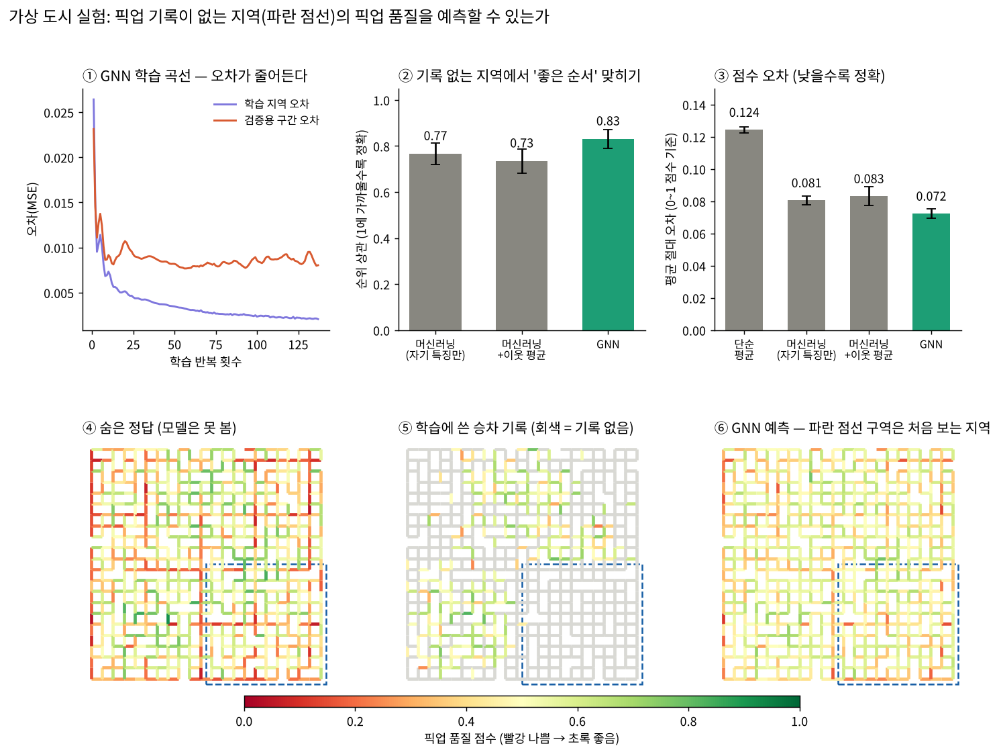

# 픽업 위치 추천 모델 실험 (GNN)

Pooly의 픽업 위치 추천을 **그래프 신경망(GraphSAGE)**으로 확장하기 위한 검증 실험입니다.
실제 승차 기록이 쌓이기 전이므로 **가상 도시 도로망과 가상 승차 기록**으로 학습했습니다.



## 문제 설정

- **그래프:** 도로 구간(교차로와 교차로 사이)이 노드, 같은 교차로를 공유하는 구간이 이웃(엣지)입니다.
- **구간 특징:** 차로 수, 큰길 여부, 막다른 길 여부, 주변 정류장·횡단보도·상가 수, 주정차 금지 여부, 역까지 거리
  (실제 서비스에서는 국토부 표준노드링크·OSM 도로망과 공공데이터로 채웁니다).
- **정답(라벨):** 차량이 기록한 승차의 대기 시간·정차 시간·재정차로 만든 구간별 픽업 품질 점수(0~1).
  진짜 품질은 자기 특징과 **이웃 구간의 특징**(옆에 큰길이 있어 진입이 쉬운지 등)으로 정해지며, 모델은 승차 기록을 통해서만 간접적으로 봅니다.
- **평가:** 지도의 오른쪽 아래 1/4을 통째로 숨기고(학습에 쓰지 않음), 나머지 지역 기록으로 학습한 뒤 숨긴 지역 169개 구간의 품질을 맞힙니다.

## 결과 (5회 반복 평균)

도로 구간 814개, 가상 승차 기록 2,500건

| 모델 | 평균 절대 오차 ↓ | 순위 상관 ↑ |
|---|---|---|
| A. 단순 평균 | 0.124 | — |
| B. 머신러닝 (자기 특징만, Gradient Boosting) | 0.081 | 0.77 |
| C. 머신러닝 + 이웃 특징 평균 | 0.083 | 0.73 |
| **D. GNN (GraphSAGE, 2층)** | **0.072** | **0.83** |

- 학습하지 않은 지역에서 GNN의 오차가 단순 평균보다 약 42%, 자기 특징만 쓰는 머신러닝보다 약 11% 낮았습니다.
- 이웃 특징을 손으로 평균 내 넣는 방식(C)은 오히려 나빠졌고, 이웃 정보를 섞는 방법 자체를 학습하는 GNN이 가장 좋았습니다.
- 한계: 가상 데이터 실험이며, 추천 상위 3곳의 품질은 B와 비슷했습니다(0.68 vs 0.68). 실제 도로망·공공데이터로 다시 검증할 예정입니다.

## 실행

```sh
cd ml
python3 -m pip install -r requirements.txt
python3 train.py     # 가상 도시 생성 → 4개 모델 학습·평가 → results.json
python3 plot.py      # results.png
```

## 서비스 적용 계획

학습은 서버 밖에서 주기적으로 하고, 도로 구간 × 시간대별 예측값만 서버에 올립니다.
추천 API(`GET /api/pickup-recommendations`)는 지금의 기록 기반 점수 대신 이 예측값과 거리로 순위를 매깁니다.
